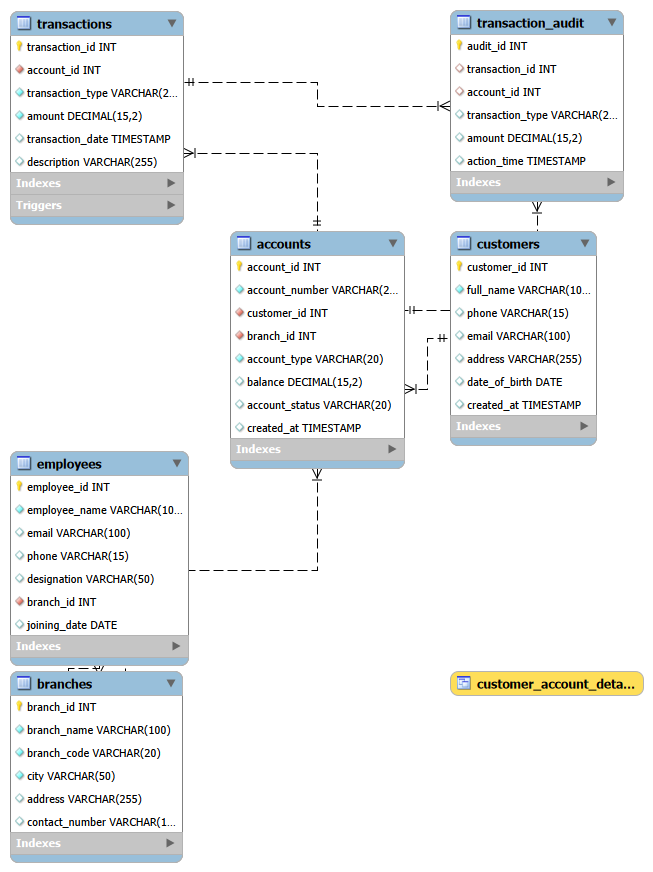

# Banking Management System

A web-based Banking Management System developed as a B.Tech Computer Science and Engineering DBMS project.

## Project Overview

The Banking Management System provides a simple interface to manage basic banking operations. It connects a Java backend with a MySQL database and a web-based frontend.

## Technologies Used

- **Frontend:** HTML, CSS, JavaScript
- **Backend:** Java
- **Database:** MySQL
- **Database Connectivity:** JDBC (MySQL Connector/J)
- **Development Tools:** VS Code, MySQL Workbench
- **Version Control:** Git and GitHub

## Main Features

- Banking dashboard
- Account management
- Deposit operations
- Withdrawal operations
- Balance enquiry
- Transaction management
- MySQL database connectivity

## Project Structure

```text
BankingManagementSystem/
├── lib/
├── src/
├── web/
├── BankingManagementSystem.mwb
├── .gitignore
└── README.md
```

## Database Design

The project database is designed using MySQL Workbench. The database model includes the Entity Relationship (ER) diagram and database structure.

## How to Run

1. Install Java JDK.
2. Install MySQL Server and MySQL Workbench.
3. Configure the MySQL database.
4. Add MySQL Connector/J to the Java project.
5. Configure the database connection details.
6. Run the Java backend.
7. Open the web application in a browser.

## Project Purpose

This project demonstrates practical implementation of DBMS concepts, Java programming, database connectivity, and web application development.

## Developer

Devarashetty Sahasra

B.Tech – Computer Science and Engineering
## ER Diagram


